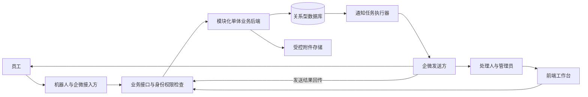
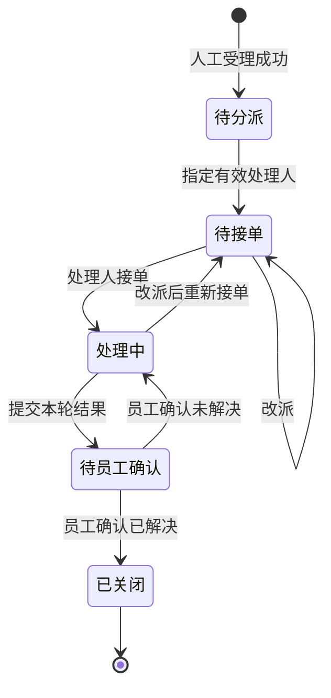

# 内部 IT 行政工单后端架构设计

2026-11-06 增量说明。用户两轮回复已确认首版本地测试的业务范围，详见 [需求说明](requirements.md) 及 [决策 N05～N13](decisions.md)。本设计中问题记录分期、会话关联、撤销、透明范围、评价及差评复核等按该基线执行，其余工程细节继续作为候选方案。

建议采用模块化单体：一个业务后端统一管理问题、人工工单、权限与状态，一个关系型数据库保存业务事实和通知任务。机器人、企微接入和前端通过业务接口协作。初期不引入微服务、通用流程引擎、独立消息队列或搜索平台。

本文是供评审的候选方案，不代表已有实现或技术选型获批。已确认业务约束以 [需求说明](requirements.md) 和 [D10～D14](decisions.md) 为准；执行限制见 [项目规则](../AGENTS.md)，动态授权和进度见 [快速恢复](quick-resume.md)。除明确引用的已确认原则外，下文均为设计建议。

## 设计依据与范围

已阅读本目录项目规则、README、快速恢复、需求、决策、业务范围、执行交接、架构及开发文档，并读取参考 PRD 正文。原 PRD 的强制评价、低分自动重开及冲突的 SLA 数值不作为冻结依据，问题索引沿用执行交接 B01～B09。本次核对正文业务内容，不进行 Word 排版审查。

业务主线：记录所有问题 → 机器人回答 → 任一转人工条件成立 → 人工受理 → 分派接单 → 处理 → 员工确认 → 关闭或继续处理；评价独立且自愿。机器人回答后的确认方式仍待定，未反馈保留为未知。

本后端负责问题与工单、权限、处理历史、结果确认、通知任务及查询统计。外部团队负责模型、RAG、会话、语音转写、企微接入与消息发送；前端负责工作台。分类出现 MES、SAP 等名称不意味着集成对应系统。采购审批、资产管理、知识发布不纳入第一阶段建议范围。

## 系统组成

图表示职责与数据流，不表示已经配置通信或部署设施。API 和通知执行器可来自同一应用、同一部署单元，后续按负载分进程。数据库是工单状态唯一事实来源，机器人、卡片和工作台展示后端返回的状态。

| 模块 | 职责及拥有的数据 | 边界 |
| --- | --- | --- |
| 接入与身份 | 调用方、员工映射、请求编号和权限上下文 | 不信任正文自报身份，不接管企微回调 |
| 问题记录 | 问题、消息关联、回答及反馈 | 所有问题记录不等于全量聊天存档 |
| 工单处理 | 受理、分派、接单、改派、进展、结果及历史 | 通过业务动作修改，不允许任意写状态 |
| 配置分派 | 分类、地点、处理组、人员有效性和兜底 | 地点与分类独立；自动轮询可后续实施 |
| 确认评价 | 每轮结果确认和独立评价 | 评分不推导是否解决 |
| 通知任务 | 创建任务、交接、失败和发送结果 | 发送成功不等于已读或确认 |
| 查询统计 | 权限过滤后的列表、详情和汇总 | 首版直接读业务库，不另建分析平台 |

代码职责按接口层、应用用例、领域规则、存储及外部适配划分。应用用例协调事务，业务模块通过明确入口协作，不允许控制器直接修改其他模块的数据。不为每个实体增加独立服务或通用抽象。

## 业务对象与数据关系

建议问题与人工工单分离，兼顾所有问题记录和人工工作量统计。首版候选关联为：一个问题包含多条消息及反馈，最多关联一张人工工单；一个会话允许包含多个问题。关闭后再次报障如何关联另定，不按相同描述自动合并。

接入方提供稳定的 `sourceIssueId`，与来源及企业范围共同确定问题，后端返回 `issueId`。`conversationId` 仅表示会话，不能替代问题编号。若接入方无法提供问题粒度标识，应先创建问题并携带后端编号追加内容，不由后端猜测消息归属。

最低人工受理条件建议为：可信提交人、来源问题标识、非空描述及转人工原因。标题可由描述生成，分类、地点与优先级暂缺时进入人工分诊；分诊是待分派阶段的属性，不另增主状态。此策略须裁定 B03，不能视为已经批准。问题记录成功与人工受理成功分别表达。

| 逻辑实体 | 关键字段与约束 |
| --- | --- |
| Person / ExternalIdentity | 内部人员编号、来源企业、原始标识、标识类型、映射状态和有效性；外部标识组合唯一 |
| Issue | 编号、来源问题编号、提交人、必要描述、创建时间、自助结果未知／已解决／未解决 |
| IssueEntry | 问题、来源消息编号、消息类型、必要内容、反馈来源、发生及接收时间 |
| Ticket | 内部及展示编号、问题、提交人、分类、地点、优先级、组、负责人、状态、整数版本号及关键时间 |
| TicketActivity | 操作人、动作、前后状态／负责人、原因、时间及可见范围；保留改派和处理历史 |
| Resolution | 工单、轮次编号、处理结果、提交人及提交时间；不静默覆盖已提交结果 |
| Confirmation | 结果轮次、确认人、已解决／未解决、说明和时间；每轮至多一份有效确认 |
| Evaluation | 工单、评价人、评分、评语和时间；未评价为无记录，不是零分 |
| Attachment | 所属问题／记录、受控存储位置、上传者、大小、媒体类型及可见范围 |
| Category / Location / SupportGroup / Membership | 分类、地点、组、人员关系及启停状态；停用不破坏历史 |
| RoleGrant | 人员、角色、范围及有效期；配置权限与业务数据权限分离 |
| RequestRecord | 调用方、企业范围、动作、请求编号、目标、业务字段及结果引用；组合唯一 |
| NotificationTask / DeliveryAttempt | 业务事件、收件人、模板、资源、任务状态、尝试编号、重试时间及发送回执 |

这是逻辑模型，不是已批准的物理表清单。主外键、非空和唯一约束用于业务关系；不设计内容摘要、校验和或完整性验证机制。Ticket.issueId 的唯一约束落实一问题一工单，若业务确认一问题多工单，再修改关系和统计口径。

历史不通过日常接口修改；仅保留必要业务变化，不保存凭证或全部聊天。附件是否进入首版、保存期限及删除规则待定。

## 工单状态与动作

以下为候选五状态方案，状态名称及异常处置仍待 B02 裁定。

| 动作 | 候选执行权限与条件 | 原子保存的结果 |
| --- | --- | --- |
| 转人工 | 可信接入方代提交人；四类原因任一成立 | 工单、初始历史、通知任务及请求结果；已有工单返回原编号 |
| 分派 | 负责范围内分派人员；待分派、目标有效 | 组及负责人、待接单、历史及通知 |
| 接单 | 当前指定处理人；待接单、版本匹配 | 处理中、接单时间及历史；不自动填首次人工响应 |
| 改派 | 有范围权限的分派人员；待接单或处理中；原因必填 | 新负责人、待接单、历史及双方通知；交接责任待定 |
| 追加进展 | 当前处理人；允许的状态；明确可见范围 | 进展及附件关联；仅公开进展可通知员工 |
| 提交结果 | 当前处理人；处理中、结果非空 | 新结果轮次、待员工确认、历史及邀请 |
| 确认未解决 | 原提交人；待确认、结果轮次有效 | 本轮确认、处理中、历史及处理人通知 |
| 确认已解决 | 原提交人；待确认、结果轮次有效 | 本轮确认、关闭时间、已关闭及历史；不要求评价 |
| 提交评价 | 原提交人；开放阶段待定 | 独立评价记录，不修改状态 |

客户端确认必须携带 `resolutionId`，旧卡片不能确认新的处理结果。无人回复保持待确认，不自动认定解决；提醒频率、次数及最终处置另定。评分不替代结果确认，低分复核作为后续候选能力。

首版暂不开放撤销和关闭后重开接口，待规则确认后扩展，不代表永久禁止。待确认期间改派、原处理人失效、员工离职等恢复路径须明确，不能用管理员任意改状态代替业务设计。

## 身份与权限

区分“哪个系统调用”和“有权代表哪个员工执行什么动作”。员工身份来自可信接入上下文，正文中的 submitterId、操作人或角色不能证明授权。前端身份与机器人代员工操作映射到同一内部人员体系。

保留来源原始用户标识及类型，映射结果另存；转换失败或空结果不证明员工不存在，不用显示名猜测身份。身份无法建立时返回明确错误，由接入方保留请求、重试或人工核实，不按匿名员工创建正式工单。

| 角色 | 候选可见范围 | 候选操作 |
| --- | --- | --- |
| 员工 | 本人问题、工单和公开记录及附件 | 补充、结果确认、自愿评价 |
| 处理人 | 当前分配工单及授权内部记录 | 接单、进展、提交结果；改派权限另定 |
| 分派人员／组长 | 授权处理组及兜底队列 | 分派、改派、异常处理；不能代员工确认 |
| 配置管理员 | 授权配置范围 | 分类、组、人员映射等管理；不自动获得全量内容权限 |
| 管理者 | 授权聚合统计 | 报表；详情和导出另行授权 |
| 集成调用方 | 约定企业及动作范围 | 问题记录、代员工动作或通知回传；不使用管理员通用权限 |

角色叠加和实际范围待 B06 裁定。每次请求同时检查动作、资源范围及字段可见性；列表、总数、详情、附件、通知和导出遵循同一规则。候选改派后原处理人不因历史分配保留权限；协作权限另行授予。

附件继承所属记录的可见范围，下载时再次检查权限。内部备注不进入员工响应、通知或知识检索。不可访问编号采用一致响应，避免向员工泄露他人工单存在性。

认证、传输、附件扫描、数据库和部署工具按当前全局规则及实际任务范围实施。用户已于 2026-11-06 纠正规则范围，正常安装和使用工具自带的签名、摘要、校验和、HTTPS/TLS 及数据库内部校验均允许使用。保留默认安全机制，额外新增的内容完整性验证按全局规则取得授权，详见决策 N17。

## 接口契约草案

路径仅为建议命名。来源发生时间与后端接收时间分开，状态时间以后端保存为准；建议存 UTC，按业务时区展示，SLA 日历另定。

| 接口 | 主要输入 | 成功语义 |
| --- | --- | --- |
| `POST /api/v1/issues` | requestId、sourceIssueId、来源消息、描述、可信身份 | 问题已保存，返回 issueId，不等于人工受理 |
| `POST /api/v1/issues/{id}/entries` | requestId、消息编号、类型、内容 | 追加回答、反馈或补充 |
| `POST /api/v1/issues/{id}/handoff` | requestId、转人工原因及必要字段 | 工单持久化，返回 ticketId、状态及通知状态 |
| `GET /api/v1/tickets` | 筛选、分页 | 权限范围内列表及总数；设置分页上限 |
| `GET /api/v1/tickets/{id}` | 工单编号 | 可见详情、版本、允许动作和过滤后的时间线 |
| `POST /api/v1/tickets/{id}/assignments` | requestId、expectedVersion、目标、原因 | 分派或改派成功 |
| `POST /api/v1/tickets/{id}/accept` | requestId、expectedVersion | 当前处理人接单 |
| `POST /api/v1/tickets/{id}/activities` | requestId、expectedVersion、内容、可见范围、附件编号 | 进展保存 |
| `POST /api/v1/tickets/{id}/resolutions` | requestId、expectedVersion、处理结果 | 返回 resolutionId，等待确认 |
| `POST /api/v1/tickets/{id}/confirmations` | requestId、expectedVersion、resolutionId、解决结果 | 确认对应轮次并返回最新状态 |
| `POST /api/v1/tickets/{id}/evaluations` | requestId、评分、评语 | 单独保存评价；时点与修改规则待定 |
| `POST /api/v1/notification-results` | notificationId、attemptId、发送事件编号、结果 | 登记发送结果，不重复执行工单动作 |

配置、附件与统计接口在范围确认后细化，遵循同一权限及错误约定。不提供允许调用方任意设置 status、submitter、closedAt 的通用更新接口。

错误区分字段无效、身份未建立、无权执行、资源不可访问、版本或状态冲突、限流及暂时故障。未收到响应或暂时故障时以原请求编号重试；修正业务字段后使用新编号。冲突时返回可访问资源的最新版本，要求重新读取，不无条件覆盖。

## 事务与并发

一个业务事务保存当前对象、处理历史、确认或评价、通知任务和请求结果。提交成功后才返回业务成功。通知失败不回滚已提交工单，也不改写为建单失败。

幂等范围为“调用方 + 企业范围 + 动作 + requestId”。保存明确的业务字段和值，逐项比较编号复用的请求，不比较追踪字段，不计算内容哈希。同编号同内容返回原结果，同编号不同目标或内容返回冲突。并发同编号由唯一约束保证单次受理，失败方读取已提交结果。请求记录保留期至少覆盖双方约定重试窗口，时长待定。

不同请求编号同时转人工由 Ticket.issueId 唯一约束防止重复建单。接单、改派、提交结果及确认依据整数 version 和当前状态条件更新；更新未命中时返回冲突，历史和通知写入随事务回滚。不能先查状态再无条件保存。

结果确认同时检查有效轮次与确认唯一约束；相同轮次相同结果可返回原结果，反向确认不得覆盖。展示编号由数据库序列或等效并发安全方式分配，允许跳号，不以数量加一或内容生成。

## 通知可靠性

采用数据库任务表：业务事务内记录任务，事务外交给发送方。任务保存业务事件编号、接收人、模板及版本、资源、状态和尝试信息；同一事件、接收人及模板组合唯一。

后端负责可靠交接，发送方接受后负责企微投递及重试并回传结果。交接响应丢失时后端以同一 notificationId 重试，发送方必须按编号去重；若不支持，只能披露可能重复通知并决定处置，不能承诺消息只到达一次。

候选任务状态为待交接、交接中、已接受、发送成功、最终失败。执行器领取任务带租约和尝试编号，崩溃后重新领取。未知结果按原编号查询或重试，不产生新业务事件；过期失败回传不能覆盖后续成功。超出约定重试次数进入可查询的失败列表，不无限重试。

卡片点击仍执行身份、版本与结果轮次检查。发送前重新检查接收人权限，改派后跳过失效处理人通知；内部内容不放入员工消息。重试、提醒及发送时限不沿用 PRD 中未经裁定的数值。

## 分派和异常兜底

首版建议“分类 + 地点 → 处理组”，由组内人工指定负责人，保留自动选择人的扩展位置。无人匹配时进入具名兜底组的待分派队列。分类不明、人员停用、组无成员及未接单须可查询、可人工接管，不能虚报接单。

上线前指定实际兜底组与负责人；缺少配置不能宣称受理闭环可用。改派校验目标有效性并保留前后负责人和原因，不能虚构人员或任意跨部门分派。待确认阶段负责人失效、员工离职及长期不回复须裁定恢复动作。

## 查询统计与运行设计

首版采用业务库索引及聚合查询。按权限范围、状态、负责人／组、提交人和创建时间安排必要索引；来源关联和幂等键使用唯一约束，具体索引由真实查询决定。

| 指标 | 口径边界 |
| --- | --- |
| 问题量与人工工单量 | 分别按问题和工单计数 |
| 自助结果 | 已确认解决、未解决、未知分列；已回答不等于已解决 |
| 首次人工响应 | 首个符合定义的人工公开响应，自动回执和接单另存；定义待批 |
| 处理及确认时间 | 每轮结果独立记录，不覆盖历史 |
| SLA 及解决时长 | 先保存原始时间，待阈值、日历、暂停和终点确认后计算 |
| 满意度 | 分数、有效评价数及覆盖率分列，未评价不计零分 |
| 线上化率 | 缺线下分母时不输出比率 |

目前没有规模、峰值、附件量或部署环境证据，不提供容量承诺。PRD 的三秒回执、一分钟通知和 99.5% 可用性只能作为待评审目标，不能声称达标。

建议部署为一套 API／执行器应用、一套关系型数据库和受控附件存储。业务、幂等及通知事实持久化，重启后从库恢复任务。需要容量或可用性证据时再增加应用副本、独立执行器或数据库冗余。

日志保留请求追踪编号、动作、工单编号和错误类别，不含凭证、令牌及完整消息。监控业务错误、版本冲突、待分派积压、通知失败和数据库不可用。备份频率、恢复目标、留存、删除及数据库与附件的恢复责任待定；实施备份工具也须遵守全局限制，不默认增加完整性验证。

## 技术选择与实施分期

推荐逻辑架构，不在缺少团队信息时冻结语言、框架、数据库产品和部署平台。优先复用团队已维护的后端栈及关系型数据库，所选方案需支持事务、唯一约束和条件更新，并核实实际运行机制符合规则。旧 Node／SQLite 原型不构成选型依据。

冻结技术方案需要团队现有栈、运维平台、身份来源和预计规模。无需为本次设计安装依赖或访问实际服务；本文没有批准相关机制例外。

建议分期如下，尚非已批准排期：

1. 核心闭环：问题记录、人工受理、人工分派接单、处理结果、员工确认及自愿评价；同时具备权限、历史、通知和基础查询接口。
2. 运营增强：获确认的 SLA、无人回复提醒、自动分派、低分复核与统计。先明确口径，再实现。
3. 按实际需求扩展多人协作、合并、知识审核接口或独立统计设施，不提前建设通用平台。

## 评审待决事项

| 优先级及关联 | 需决定内容 | 本方案建议及影响 |
| --- | --- | --- |
| 核心 | 自建还是接入既有系统 | 本方案按自建假设；改为接入需先验证真实 API，不凭 UI 推断 |
| 核心 B03 | 问题粒度、最低受理字段 | 问题与工单分开，一问题一工单，允许分诊；影响数据和对接 |
| 核心 B02 | 状态、改派、无人回复、重开 | 五状态，无人回复不判解决；影响状态机及异常操作 |
| 核心 B05 | 兜底组及交接责任 | 人工分派起步，具名兜底；影响受理上线 |
| 核心 B06 | 身份来源、映射和权限矩阵 | 可信上下文、角色加资源范围；影响全部接口 |
| 对接 B07 | 备注附件可见性、发送责任 | 内外分离；后端交接、外部投递；影响泄露防护及重试 |
| 业务 B01/B08 | 机器人结果确认、评价时点和低分 | 未反馈未知，评分不改变状态；影响反馈和报表 |
| 运营 B04 | SLA 日历、阈值及计时 | 先记录原始动作时间；影响超时计算 |
| 工程 | 栈、规模、留存、运维 | 团队能力和实际规模决定；影响部署恢复 |

## 验证边界

实现后重点验证：所有问题记录、四类转人工原因、重复请求及并发转人工不重复建单、接单改派冲突、旧轮次确认、未解决继续处理、未评价可以关闭，以及越权列表／详情／附件和内部备注隔离。

事务及通知还需验证：提交失败不返回成功；提交成功但响应丢失可恢复；通知失败不丢工单；执行器重启及乱序回执不重复业务动作。完整闭环验收需要机器人、接入方和前端共同参与。

这些是未来验收场景，不是已执行测试。本次仅完成设计与文档一致性核对，没有业务测试、容量测量、部署或端到端验收。未决项只阻塞依赖它的实施，继续评审其他部分。
